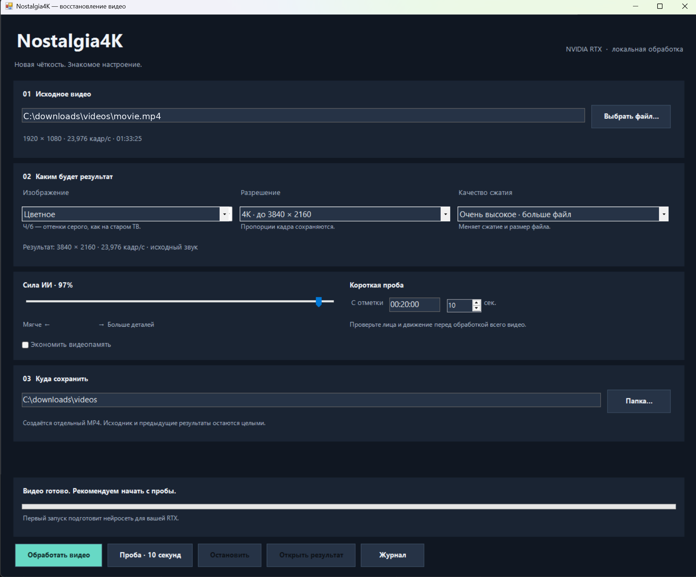

# Nostalgia4K Desktop



## Установщик и приложение с интерфейсом

1. Распакуйте **весь архив** в удобную папку.
2. Дважды нажмите **Setup.cmd** — откроется графический установщик.
3. Если предыдущая версия уже находится в `C:\downloads\Nostalgia4K`, оставьте
   эту папку в установщике. Существующие `.venv`, модели, инструменты и кэш
   не удаляются. Недостающие библиотеки установятся автоматически.
4. Нажмите **Установить / обновить**, дождитесь проверок, затем **Открыть Nostalgia4K**.
5. Для следующих запусков используйте ярлык на рабочем столе или **Start.cmd**.

Установщик — обычное окно Windows; для него не требуется отдельная библиотека
интерфейса. Он использует Windows Forms и Windows PowerShell 5.1. Исходники
приложены; самостоятельного подписанного EXE в этом архиве нет.

На основном экране:

- **Выбрать файл** или перетащить видео в окно.
- **Цветное / Чёрно-белое** — по умолчанию цветное.
- **Разрешение:** 4К, 1440p, 1080p, размер исходника или увеличение ровно в 2 раза.
  Для нестандартных пропорций сохраняется форма кадра. Например, видео 4:3
  при выборе 4К станет 2880×2160, без растяжения до 16:9.
- **Качество сжатия:** высокое, компактный файл, очень высокое. Это настройки
  NVENC, влияющие на потери и размер файла; они не меняют саму нейросеть.
- **Сила ИИ:** от более мягкого результата до полного эффекта модели.
- **Проба:** по умолчанию 20 секунд с отметки 00:03:00. Начало и длину можно менять.
- **Папка сохранения**, прогресс, оставшееся время, остановка, журнал и открытие результата.

Кнопки запуска и прогресс всегда находятся внизу окна. На небольшом экране
настройки можно прокручивать. Последний файл и настройки сохраняются локально.
Результаты не перезаписываются: если имя занято, добавляется номер.

| Качество в интерфейсе | NVENC | CQ |
|---|---|---|
| Высокое · рекомендуется | p7 | 18 |
| Компактный файл | p5 | 22 |
| Очень высокое · больше файл | p7 | 15 |

Модель Real-ESRGAN выполняет восстановление ×2, затем изображение приводится
к выбранному размеру. Разрешение само по себе не гарантирует дополнительных
деталей. Первое построение движка TensorRT может занять несколько минут;
переключение цвета, разрешения или качества сжатия использует тот же движок.

Звук AAC/MP3/ALAC копируется. Другие аудиокодеки интерфейс автоматически
перекодирует в AAC для совместимости с выходным MP4.

---

## Обработка через командную строку

Программа для Windows x64 и NVIDIA RTX: нейросетевое увеличение видео в 2 раза,
чёрно-белая картинка и сохранение MP4 через аппаратный H.264 NVENC.
Например, для исходника 1920×1080 с частотой 24000/1001 результат — 3840×2160 с той же частотой.

Нейросеть: готовые веса Real-ESRGAN x2plus. Исполнение: NVIDIA TensorRT 10.13,
CUDA 12.8 и Tensor Cores. Сжатие: NVIDIA NVENC, p7, CQ 18.
Это самостоятельно написанная программа обработки; обучение нейросети с нуля
не производится. Модель Real-ESRGAN создана её авторами, а не NVIDIA.

## Установка

Распакуйте архив в `C:\downloads`, чтобы получилась папка
`C:\downloads\Nostalgia4K` с файлами `Install.ps1` и `Start.ps1` внутри.
Исходное видео можно хранить в любой папке; в окне программы выберите файл.

Откройте PowerShell и выполните:

```powershell
powershell.exe -NoProfile -ExecutionPolicy Bypass -File C:\downloads\Nostalgia4K\Install.ps1
```

Установка создаёт отдельное окружение Python в папке программы. Если Python
3.11/3.12 не найден, установщик попробует установить Python 3.12 через winget
для текущего пользователя. При отсутствии winget установите Python 3.12 x64
с https://www.python.org/downloads/windows/ и повторите команду.

Загружаются PyTorch с CUDA, TensorRT, FFmpeg и FFprobe. Загрузка может составить
несколько гигабайт. Драйвер NVIDIA должен поддерживать CUDA 12.8; рекомендуется
актуальный Studio Driver. Отдельно устанавливать весь CUDA Toolkit для этого
Python-варианта не требуется: используются двоичные пакеты с зависимостями.

Установщик проверяет реальную работу CUDA и пробное кодирование NVENC.
Если установщик сообщает ошибку, весь его вывод нужен для диагностики.

## Сначала проба на 20 секундах

```powershell
powershell.exe -NoProfile -ExecutionPolicy Bypass -File C:\downloads\Nostalgia4K\Start.ps1 -Preview
```

Берётся фрагмент с 3:00 по 3:20. Модель скачивается автоматически с официального
GitHub Real-ESRGAN; SHA256 проверяется перед загрузкой весов. При первом запуске
TensorRT собирает оптимизированный движок, что может занять несколько минут.
При следующих запусках используется кэш для этого GPU и набора настроек.

Результат появится рядом с исходником: `название_ai4k_bw_preview.mp4`.
Посмотрите лица, контуры, движение и фон: ИИ может выдумывать мелкие детали,
сглаживать плёнку и вызывать мерцание между кадрами. Алгоритм покадровый;
временная согласованность нейросетью отдельно не моделируется.

## Обработать весь фильм

```powershell
powershell.exe -NoProfile -ExecutionPolicy Bypass -File C:\downloads\Nostalgia4K\Start.ps1
```

Результат: `название_ai4k_bw.mp4`. Оригинал не изменяется.
Файлы `_bw.mp4`, `_bw_nvenc.mp4`, предыдущие `_ai4k...` и временные файлы
при автоматическом поиске исходника исключаются.

Если в папке с программой нет единственного исходного видео, укажите файл явно:

```powershell
powershell.exe -NoProfile -ExecutionPolicy Bypass -File C:\downloads\Nostalgia4K\Start.ps1 -InputFile "D:\Видео\фильм.mp4"
```

Новое окно PowerShell:

```powershell
Start-Process powershell.exe -ArgumentList '-NoProfile -ExecutionPolicy Bypass -NoExit -File "C:\downloads\Nostalgia4K\Start.ps1" -Preview'
```

ИИ-обработка использует вычислительные блоки и память GPU; её лучше проверять
после завершения уже запущенного NVENC-кодирования, чтобы измерить её скорость
без конкуренции за ресурсы. Она существенно тяжелее простого перевода в Ч/Б.
После первых кадров программа покажет скорость, прогресс и примерное время.

## Настройка результата

Все параметры передаются после `Start.ps1`:

| Параметр | Назначение |
|---|---|
| `-Preview -Start 600 -Seconds 15` | Проба на 15 секундах с отметки 10:00 |
| `-Strength 0.5` | Более мягкий эффект, больше исходной фактуры |
| `-Strength 1` | Полный результат нейросети |
| `-Color` | Сохранить цвет |
| `-CQ 16` | Меньше потерь при кодировании, обычно больший файл |
| `-Tile 128` | Меньше расход видеопамяти, больше частей кадра |
| `-Halo 64` | Больше контекста по краям частей, если заметны стыки; медленнее |
| `-Precision fp32` | Диагностика численной точности; медленнее и больше памяти |
| `-Backend torch` | CUDA-исполнение через PyTorch вместо TensorRT |
| `-OutputFile "D:\Видео\проба2.mp4"` | Другое имя результата; существующие файлы не перезаписываются |
| `-Doctor` | Проверка CUDA, TensorRT и NVENC |
| `-Prepare` | Только скачать модель и собрать/загрузить движок |

По умолчанию Strength = 0.75: смешиваются 75% результата ИИ и 25% увеличенного
оригинала для более мягкой обработки. Чёрно-белое преобразование делается после
нейросети, чтобы модель работала с оригинальным цветным материалом.

## Звук, совместимость и ограничения

- Звук копируется без перекодирования, если кодек совместим с MP4.
  Для источника с несовместимым аудиокодеком вызовите Python с
  `--audio-codec aac`; пример ниже.
- Изменения частоты кадров на 60 fps не выполняются. Источники с переменной
  частотой нормализуются до постоянной средней частоты. Это не интерполяция ИИ.
- Обрабатывается первый видеопоток и все аудиопотоки. Субтитры и главы не переносятся.
- Программа рассчитана на SDR BT.709. HDR и повёрнутые
  видео не входят в этот сценарий. Нестандартное разрешение увеличивается
  ровно вдвое, без растяжения до фиксированных размеров 4К.
- Кадры не раскладываются на диск. В памяти находятся текущий кадр и его части.
- Ctrl+C останавливает процесс. Автоматическое продолжение прерванной обработки
  не реализовано. Незавершённый файл `.part.mp4` остаётся для диагностики,
  а готовое имя получает только успешно завершённый результат.
- Логи FFmpeg находятся в `logs`, параметры успешной обработки — в JSON рядом
  с готовым MP4. Этот JSON не содержит оценку улучшения качества.
- Программа работает локально; видео на сервер не отправляется.

Пример прямого вызова с перекодированием звука:

```powershell
& C:\downloads\Nostalgia4K\.venv\Scripts\python.exe C:\downloads\Nostalgia4K\app.py --input "D:\Видео\фильм.mkv" --audio-codec aac --seconds 20
```

## Что проверено

В среде разработки проверяются загрузка официальных весов, выполнение модели
на CPU, структура экспортированного ONNX, геометрия сборки частей кадра,
преобразование в оттенки серого, потоки FFmpeg со звуком и дробная частота кадров.
Видеокарты NVIDIA RTX и Windows в среде разработки отсутствуют: фактическое исполнение
TensorRT/CUDA/NVENC и PowerShell-установщика нужно проверить командой `-Doctor`
и короткой пробой на целевом ПК. Скорость и отсутствие артефактов не гарантируются.

## Источники и лицензии

- Модель: https://github.com/xinntao/Real-ESRGAN, BSD-3-Clause, `LICENSE-RealESRGAN.txt`.
- Архитектура RRDB: https://github.com/XPixelGroup/BasicSR, Apache-2.0, см. `LICENSE-BasicSR.txt`.
- NVIDIA TensorRT Python API: https://docs.nvidia.com/deeplearning/tensorrt/10.x.x/inference-library/python-api-docs.html
- PyTorch CUDA 12.8: https://pytorch.org/get-started/previous-versions/
- FFmpeg Windows builds: https://www.gyan.dev/ffmpeg/builds/.

Зависимости и веса распространяются на условиях их собственных лицензий.
Веса, FFmpeg, CUDA и TensorRT не включены в архив; установщик получает их из
указанных источников. Исходный код программы приложен полностью.
